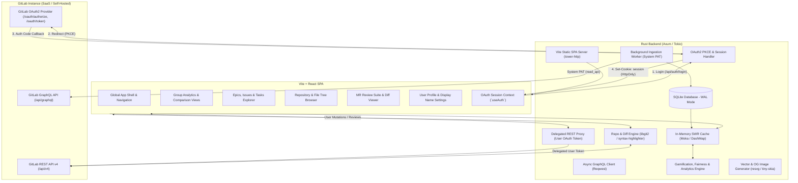
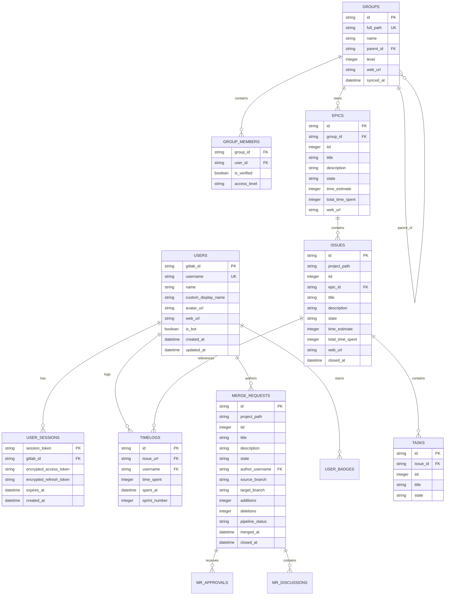

# Software Requirements Specification (SRS): GitLab Unified Team & Engineering Platform

**Document Version:** 2.0.0  
**Classification:** Clean Room Engineering Specification  
**Architecture:** Rust (Axum/Tokio) Backend + SQLite + Vite/React SPA + Dual Auth (System PAT + GitLab OAuth2)  
**Target System:** High-Performance GitLab Companion Platform (Analytics, Gamification, Work Items, Code Browser, MR Review Suite)  

---

## 1. Executive Summary & Mission

### 1.1 Purpose
This document specifies the architecture, data models, database schema, API contracts, mathematical formulas, and user experiences required to build a clean-room implementation of the **GitLab Unified Engineering & Team Analytics Platform**. 

An independent engineering team must be able to develop an identical, fully operational system from this specification alone, without inspecting proprietary or prior source code.

### 1.2 System Mission & Scope
The platform evolves from a pure time-tracking dashboard into a **full-featured, blazingly fast GitLab companion platform** designed for engineering teams, university cohorts, and organizations:
1. **Workload & Effort Analytics:** Multi-tier GitLab group hierarchy ingestion, automatic sprint boundary calculation, category breakdowns, and effort fairness metrics.
2. **Gamification Engine:** Non-inflationary XP progression, piecewise-linear tier/leveling curves, and a comprehensive 7-track badge achievement catalog.
3. **SQLite Persistence Layer:** High-speed embedded database for local caching, historical timelog snapshots, user sessions, and persistent customizations.
4. **User Profile & Custom Display Names:** Authenticated users can configure a custom display name shown across all tables, charts, leaderboard entries, and avatar tooltips.
5. **Work Items (Epics, Issues & Tasks) Explorer:** Direct browsing and inline management of Epics, Issues, Tasks, Milestones, and Iterations with Markdown rendering and task checklist tracking.
6. **Code & Repository Browser:** Directory tree navigation, syntax-highlighted blob viewer, and commit history logs.
7. **Merge Request (MR) Review Suite:** Unified and split diff viewer, discussion threads, reviewer approvals, and CI/CD pipeline status tracking.
8. **Dual Authentication Model:** Headless background ingestion via a System Personal Access Token (PAT) paired with interactive GitLab OAuth 2.0 PKCE login for user sessions and write operations.

---

## 2. System Architecture & Dual-System Topology



### 2.1 Architectural Boundaries
1. **Frontend Client (Vite + React SPA):**
   - Built with Vite, React 19, TypeScript, and modern component styling.
   - Single-Page Application with client-side routing, optimistic UI updates, and responsive desktop/mobile/kiosk layouts.
2. **Backend Server (Rust - Axum/Tokio):**
   - High-concurrency async service running on Tokio.
   - Low memory footprint (< 30 MB RSS under load) with sub-millisecond route dispatch.
   - Embedded SQLite persistence using connection pooling and Write-Ahead Logging (WAL).
   - In-memory lock-free Stale-While-Revalidate cache (`moka` / `dashmap`).
3. **Dual Authentication Model:**
   - **System PAT (`GITLAB_TOKEN`):** Background service account token configured in server environment. Powers group discovery, timelog aggregation, and cross-group comparison caching autonomously without requiring user login.
   - **User OAuth2 Token:** Interactive users authenticate via GitLab OAuth 2.0 (Authorization Code Grant with PKCE). Access/refresh tokens are stored securely in encrypted HTTP-only cookies or server-side SQLite sessions. Write operations (issue status, estimates, label edits, MR comments) are executed using the user's personal identity.

---

## 3. Configuration & Environment Variables

| Variable | Required | Type | Default | Description |
|---|:---:|:---:|:---:|---|
| `DATABASE_URL` | No | String | `sqlite://data/platform.db?mode=rwc` | SQLite database connection string or file path. |
| `GITLAB_TOKEN` | Yes | String | - | Backend System PAT with `read_api` (and `read_repository`) for background ingestion. |
| `GITLAB_GROUP_PATH` | Yes | String | - | Full path of the root parent GitLab group (e.g. `dhbw/tinf24`). |
| `GITLAB_DOMAIN` | No | String | `https://gitlab.com` | Base URL of the GitLab instance. |
| `APP_URL` | No | String | `http://localhost:3000` | Public URL of the web dashboard (used for OAuth redirect URI and OpenGraph links). |
| `GITLAB_OAUTH_CLIENT_ID` | Optional* | String | - | GitLab Application Client ID (UID) for OAuth authentication. |
| `GITLAB_OAUTH_CLIENT_SECRET` | Optional* | String | - | GitLab Application Secret for OAuth authentication. |
| `GITLAB_OAUTH_REDIRECT_URI` | Optional* | String | `${APP_URL}/api/auth/callback` | OAuth redirect URI registered in GitLab. |
| `SESSION_SECRET` | Optional* | String | - | 32+ byte secret key for signing encrypted session cookies. |
| `PROJECT_START_DATE` | Yes | Date (`YYYY-MM-DD`) | - | Earliest timestamp filter for timelogs and anchor for sprint 1. |
| `PROJECT_END_DATE` | Yes | Date (`YYYY-MM-DD`) | - | Latest timestamp filter for timelog aggregation and sprint boundaries. |
| `SPRINT_START_WEEKDAY`| No | String / Number | Day of `PROJECT_START_DATE` | Sprint start weekday name (e.g. `Monday`) or 0–6 index (0=Sun, 1=Mon). |
| `SPRINT_DURATION_WEEKS`| No | Integer | `1` | Duration of each sprint/cycle in weeks. |
| `PORT` | No | Integer | `3000` | Port on which the Rust backend listens. |

*\*Required when GitLab OAuth 2.0 login is enabled.*

---

## 4. Domain Models & Categorization Taxonomy

### 4.1 Group Hierarchy Model
- **`DescendantGroup`**:
  - `id`: Relative path segment after `GITLAB_GROUP_PATH/` (e.g., `group-alpha` or `group-alpha/exercise-1`).
  - `fullPath`: Absolute GitLab path (e.g., `root-org/team/group-alpha`).
  - `name`: Display name of the group.
  - `parentId`: Relative ID of the parent group, or `null` if direct child of root.
  - `parentName`: Display name of parent group, or `null`.
  - `level`: Hierarchical depth (1 for teams, 2+ for nested exercises/subgroups).
  - `url`: Direct link to the GitLab group web page.

### 4.2 Member & User Verification Model
- **User Node**: `username` (unique ID), `name`, `customDisplayName`, `avatarUrl`, `webUrl`, `bot` (boolean), `verified` (boolean).
- **Verification Heuristics**:
  1. `bot` must be `false`.
  2. Username must NOT match bot patterns (`group_*`, `project_*`, `*_bot_*`).
  3. Username must NOT be an owner of the root group (`GITLAB_GROUP_PATH`), unless the user has logged timelogs in that specific subgroup.
  4. Direct members of the group, its exercises, or parent team $\rightarrow$ `verified = true`.
  5. Any user with logged time in the group $\rightarrow$ `verified = true`.
  6. Inherited members with 0 hours logged $\rightarrow$ `verified = false`.

### 4.3 Custom Display Name Resolution
Users can customize their visible display name in the platform.
The system resolves user display names via the following precedence order:
$$\text{DisplayName}(u) = \operatorname{coalesce}(\text{CustomDisplayName}(u), \text{GitLabName}(u), \text{Username}(u))$$

When `CustomDisplayName` is present, UI components may format the name as:
`Jane Doe (@jane_d)` or simply `Jane Doe` with `@jane_d` in tooltips and detail modals.

### 4.4 Work Categorization Taxonomy
Work is classified into exactly **four canonical categories** plus a fallback category:

| Category ID | Full Label | Short Code | Default Color | Matching Patterns (Case-Insensitive Regex) |
|---|---|:---:|:---:|---|
| `project-management` | Project Management | PM | `#ff7300` | `/pm\b/`, `/project/`, `/management/` |
| `requirements-engineering` | Requirements Engineering | RE | `#8884d8` | `/req/`, `/\bre\b/`, `/requirements/` |
| `implementation` | Implementation | Impl | `#82ca9d` | `/impl/`, `/implementation/`, `/\bdev\b/`, `/development/` |
| `architecture` | Architecture | Arch | `#ffc658` | `/arch/`, `/architecture/`, `/entwurf/` |
| `other` | Other / Uncategorized | Other | `#666666` | Fallback when no label matches above rules. |

#### Label Normalization Rules
1. Scoped labels formatted as `Category::Sublabel` (or `Category:Sublabel`) are parsed into group `Category` and title `Sublabel`.
2. Flat labels without colons are normalized with `Ungrouped::` prefix.
3. Priority evaluation: PM $\rightarrow$ RE $\rightarrow$ Implementation $\rightarrow$ Architecture $\rightarrow$ Other.

### 4.5 Sprint Window Generation Algorithm
1. Parse `PROJECT_START_DATE` and `PROJECT_END_DATE`.
2. Determine `targetWeekday` from `SPRINT_START_WEEKDAY` (defaults to weekday of `PROJECT_START_DATE`).
3. Advance `sprintStartDate` until `sprintStartDate.getDay() === targetWeekday`.
4. While `sprintStartDate < PROJECT_END_DATE`:
   - `sprintEndDate = sprintStartDate + (SPRINT_DURATION_WEEKS * 7 - 1) days`.
   - If `sprintEndDate > PROJECT_END_DATE`, break.
   - Record Sprint `{ sprintNumber: N, startDate: YYYY-MM-DD, endDate: YYYY-MM-DD }`.
   - `sprintStartDate = sprintEndDate + 1 day`, `N = N + 1`.

---

## 5. Gamification Engine & Mathematical Specification

### 5.1 Level and Tier System
Piecewise-linear XP progression curve:
```
Level 1: 0 XP
Level 2–9 (Bronze Tier):      200 XP per level
Level 10–19 (Silver Tier):     300 XP per level
Level 20–29 (Gold Tier):       400 XP per level
Level 30+ (Legend Tier):       500 XP per level
```

$$\text{XP}_{\text{needed}}(\text{Level}) = \sum_{l=1}^{\text{Level}-1} \text{TierXP}(l)$$

| Tier Name | Level Range | Tier Label | Color Hex |
|---|:---:|:---:|:---:|
| `bronze` | 1 – 9 | Bronze | `#cd7f32` |
| `silver` | 10 – 19 | Silver | `#c0c0c0` |
| `gold` | 20 – 29 | Gold | `#ffd700` |
| `legend` | 30+ | Legend | `#a855f7` |

### 5.2 XP Computation Rules
$$\text{TotalXP}(u) = \text{BaseXP}(u) + \sum_{b \in \text{UnlockedBadges}(u)} \text{Reward}(b)$$

1. **Hours XP:** $\text{XP}_{\text{hours}} = \lfloor \text{TotalLoggedHours}(u) \times 20 \rfloor$
2. **Issues Closed XP:** For closed issues $i$ where $u$ contributed time:
   $$\text{UserShare}(u, i) = \frac{\text{TimeSpent}(u, i)}{\sum_{v} \text{TimeSpent}(v, i)}$$
   $$\text{XP}_{\text{issues}} = \sum_{i \in \text{Closed}} \lfloor \text{UserShare}(u, i) \times \lfloor \text{EstHours}(i) \times 15 \rfloor \rfloor$$
3. **Blind Flight Penalty:** For closed issues with 0 estimate:
   $$\text{Penalty}_{\text{blind}} = \sum_{i \in \text{ClosedNoEst}} \lfloor \text{UserShare}(u, i) \times 30 \rfloor$$
4. **Sprint Consistency XP:** $\text{XP}_{\text{sprints}} = \text{Count}(\text{ActiveSprintsWithLogs}(u)) \times 25$
5. **Merge Request Authoring XP:** $\text{XP}_{\text{merges}} = \text{Count}(\text{MergedMRsToProtectedBranch}(u)) \times 50$
6. **Peer Review XP:** $(\text{ApprovedTeammateMRs} \times 15) + (\text{CommentedOnlyTeammateMRs} \times 10)$
7. **Bot Action XP:** If bot/service account, $\text{XP}_{\text{bot}} = \text{DiscussionsCount} \times 2$

$$\text{BaseXP}(u) = \text{XP}_{\text{hours}} + \text{XP}_{\text{issues}} + \text{XP}_{\text{sprints}} + \text{XP}_{\text{merges}} + \text{XP}_{\text{reviews}} + \text{XP}_{\text{bot}} - \text{Penalty}_{\text{blind}}$$

### 5.3 Complete Badges Catalog (7 Tracks)
1. **Endurance (Logged Hours):** Greenhorn (1h, 15 XP), Apprentice (10h, 50 XP), Dedicated Worker (30h, 100 XP), Deep Worker (60h, 150 XP), Century Club (100h, 200 XP), Marathoner (130h, 250 XP), Apex Contributor (150h, 400 XP).
2. **Velocity (Estimated Hours Closed):** Task Solver (5h, 20 XP), Problem Solver (20h, 50 XP), Code Crusader (40h, 100 XP), Issue Sweeper (70h, 150 XP), Task Master (100h, 250 XP), Titan of Tasks (150h, 350 XP).
3. **Shipping (Authored Merged MRs):** Continuous Integrator (5 MRs, 50 XP), Git Master (10 MRs, 100 XP), Merge Maestro (20 MRs, 150 XP), Deployment Deity (30 MRs, 250 XP).
4. **Quality (Teammate Reviews):** Eagle Eye (5 reviews, 40 XP), Code Guardian (10 reviews, 80 XP), Sentinel (20 reviews, 150 XP), The Gatekeeper (30 reviews, 250 XP).
5. **Momentum (Active Sprints & Streaks):** Sprint Jogger (2 sprints, 20 XP), Sprint Machine (6 sprints, 80 XP), Sprint Overlord (10 sprints, 150 XP), Chronos (15 sprints, 300 XP), On Fire (3 streak, 40 XP), Unstoppable (5 streak, 80 XP), Streak Legend (8 streak, 150 XP), Sprint Monarch (15 streak, 300 XP).
6. **Automation (Bot Accounts):** Ghost Writer (50 comments, 100 XP), Skynet (200 actions, 300 XP).
7. **One-Time Achievements:** First Steps (first issue, 10 XP), PR Pioneer (first MR merged, 20 XP), Sharp Shooter ($\pm 10\%$ estimate accuracy, 50 XP), Heavy Lifter ($\ge 8\text{h}$ estimate, 80 XP), Colossal Lifter ($\ge 10\text{h}$ estimate, 120 XP), Titan Lifter ($\ge 12\text{h}$ estimate, 150 XP), Full-Stack Sprint ($\ge 1\text{h}$ in all 4 categories in one sprint, 100 XP), Team Player (reviewed $\ge 3$ teammates, 50 XP), Community Pillar (reviewed $100\%$ of active teammates, 150 XP).

---

## 6. Mathematical & Statistical Metrics

1. **Effort Multiplier ($M$):** $M = \frac{\max(H)}{\min(H)}$ ($M \le 1.5$ Low, $1.5 < M \le 2.5$ Moderate, $M > 2.5$ High).
2. **Effort Gap ($\Delta H$):** $\Delta H = \max(H) - \min(H)$ hours ($\le 20\text{h}$ Low, $20–40\text{h}$ Moderate, $> 40\text{h}$ High).
3. **Coefficient of Variation ($CV$):** $CV = \frac{\sigma}{\mu}$ ($< 0.25$ Low, $0.25–0.50$ Moderate, $> 0.50$ High).
4. **Review Coverage ($RC$):** Percentage of merged MRs with $\ge 1$ peer review.
5. **Code Churn Bus Factor:** Max % share of additions+deletions by a single contributor.
6. **Peak Hero Reliance Index:** Max % share of group hours logged by a single contributor.
7. **Estimate Accuracy Log-Log Linear Regression:** Best-fit slope and intercept for $(\log(\text{Est}), \log(\text{Act}))$ data points.

---

## 7. External GitLab API & OAuth 2.0 Integration

### 7.1 GitLab OAuth 2.0 PKCE Protocol
1. **Grant Type:** Authorization Code Grant with PKCE (`code_challenge_method=S256`).
2. **Scopes:** `read_user`, `read_repository`, `api`.
3. **Endpoints:**
   - `/oauth/authorize`: Initiates login with `client_id`, `redirect_uri`, `scope`, `code_challenge`.
   - `/oauth/token`: Exchanges `code` + `code_verifier` for `access_token` and `refresh_token`.
4. **Session Storage:** Tokens encrypted using AES-256-GCM in SQLite and bound to an `HttpOnly`, `SameSite=Lax`, `Secure` session cookie.

### 7.2 GraphQL Queries & REST v4 Calls
1. **GraphQL Timelogs & Issues:** Query `timelogs` with start/end filters.
2. **GraphQL Epic Work Items:** Query `workItems(types: [EPIC])` with `TIME_TRACKING` and `LABELS` widgets.
3. **GraphQL Merge Requests:** Query `mergeRequests` with author, approvals, branch rules, and discussions.
4. **REST v4 Calls:**
   - Issue state: `PUT /projects/:id/issues/:iid` (`state_event: close|reopen`).
   - Time estimates: `POST /projects/:id/issues/:iid/time_estimate` & `/reset_time_estimate`.
   - Labels: `PUT /projects/:id/issues/:iid` (`labels: string`).
   - Tree browser: `GET /projects/:id/repository/tree?path=...&ref=...`.
   - Blob content: `GET /projects/:id/repository/blobs/:sha` or raw content.
   - Commits log: `GET /projects/:id/repository/commits?ref_name=...`.
   - MR diffs: `GET /projects/:id/merge_requests/:iid/diffs`.
   - MR discussions: `GET /projects/:id/merge_requests/:iid/discussions` and `POST .../notes`.

---

## 8. SQLite Database Architecture & Schema

The platform persists data in an embedded SQLite database using WAL mode (`PRAGMA journal_mode=WAL; PRAGMA foreign_keys=ON;`).



### 8.1 SQLite DDL Table Definitions

```sql
CREATE TABLE IF NOT EXISTS users (
    gitlab_id TEXT PRIMARY KEY,
    username TEXT UNIQUE NOT NULL,
    name TEXT NOT NULL,
    custom_display_name TEXT,
    avatar_url TEXT,
    web_url TEXT NOT NULL,
    is_bot BOOLEAN NOT NULL DEFAULT 0,
    created_at DATETIME DEFAULT CURRENT_TIMESTAMP,
    updated_at DATETIME DEFAULT CURRENT_TIMESTAMP
);

CREATE TABLE IF NOT EXISTS user_sessions (
    session_token TEXT PRIMARY KEY,
    gitlab_id TEXT NOT NULL REFERENCES users(gitlab_id) ON DELETE CASCADE,
    encrypted_access_token TEXT NOT NULL,
    encrypted_refresh_token TEXT,
    expires_at DATETIME NOT NULL,
    created_at DATETIME DEFAULT CURRENT_TIMESTAMP
);

CREATE TABLE IF NOT EXISTS groups (
    id TEXT PRIMARY KEY,
    full_path TEXT UNIQUE NOT NULL,
    name TEXT NOT NULL,
    parent_id TEXT REFERENCES groups(id) ON DELETE CASCADE,
    parent_name TEXT,
    level INTEGER NOT NULL DEFAULT 1,
    web_url TEXT NOT NULL,
    synced_at DATETIME NOT NULL
);

CREATE TABLE IF NOT EXISTS group_members (
    group_id TEXT NOT NULL REFERENCES groups(id) ON DELETE CASCADE,
    username TEXT NOT NULL REFERENCES users(username) ON DELETE CASCADE,
    is_verified BOOLEAN NOT NULL DEFAULT 0,
    access_level TEXT,
    PRIMARY KEY (group_id, username)
);

CREATE TABLE IF NOT EXISTS labels (
    id TEXT PRIMARY KEY,
    group_id TEXT NOT NULL REFERENCES groups(id) ON DELETE CASCADE,
    title TEXT NOT NULL,
    scope TEXT,
    color TEXT NOT NULL,
    description TEXT,
    category_id TEXT
);

CREATE TABLE IF NOT EXISTS epics (
    id TEXT PRIMARY KEY,
    group_id TEXT NOT NULL REFERENCES groups(id) ON DELETE CASCADE,
    iid INTEGER NOT NULL,
    title TEXT NOT NULL,
    description TEXT,
    state TEXT NOT NULL,
    time_estimate INTEGER NOT NULL DEFAULT 0,
    total_time_spent INTEGER NOT NULL DEFAULT 0,
    web_url TEXT NOT NULL,
    created_at DATETIME,
    closed_at DATETIME,
    synced_at DATETIME NOT NULL
);

CREATE TABLE IF NOT EXISTS issues (
    id TEXT PRIMARY KEY,
    project_path TEXT NOT NULL,
    iid INTEGER NOT NULL,
    epic_id TEXT REFERENCES epics(id) ON DELETE SET NULL,
    title TEXT NOT NULL,
    description TEXT,
    state TEXT NOT NULL,
    time_estimate INTEGER NOT NULL DEFAULT 0,
    web_url TEXT NOT NULL,
    labels_json TEXT NOT NULL DEFAULT '[]',
    created_at DATETIME NOT NULL,
    closed_at DATETIME,
    synced_at DATETIME NOT NULL
);

CREATE TABLE IF NOT EXISTS tasks (
    id TEXT PRIMARY KEY,
    issue_id TEXT NOT NULL REFERENCES issues(id) ON DELETE CASCADE,
    iid INTEGER NOT NULL,
    title TEXT NOT NULL,
    state TEXT NOT NULL,
    created_at DATETIME,
    closed_at DATETIME
);

CREATE TABLE IF NOT EXISTS timelogs (
    id TEXT PRIMARY KEY,
    issue_url TEXT NOT NULL,
    username TEXT NOT NULL REFERENCES users(username) ON DELETE CASCADE,
    spent_at DATETIME NOT NULL,
    time_spent INTEGER NOT NULL,
    sprint_number INTEGER,
    synced_at DATETIME NOT NULL
);
CREATE INDEX IF NOT EXISTS idx_timelogs_username ON timelogs(username);
CREATE INDEX IF NOT EXISTS idx_timelogs_sprint ON timelogs(sprint_number);
CREATE INDEX IF NOT EXISTS idx_timelogs_spent_at ON timelogs(spent_at);

CREATE TABLE IF NOT EXISTS merge_requests (
    id TEXT PRIMARY KEY,
    project_path TEXT NOT NULL,
    iid INTEGER NOT NULL,
    title TEXT NOT NULL,
    description TEXT,
    state TEXT NOT NULL,
    author_username TEXT NOT NULL REFERENCES users(username) ON DELETE CASCADE,
    source_branch TEXT NOT NULL,
    target_branch TEXT NOT NULL,
    additions INTEGER DEFAULT 0,
    deletions INTEGER DEFAULT 0,
    pipeline_status TEXT,
    web_url TEXT NOT NULL,
    approved_by_json TEXT NOT NULL DEFAULT '[]',
    discussion_authors_json TEXT NOT NULL DEFAULT '[]',
    discussion_count INTEGER DEFAULT 0,
    created_at DATETIME NOT NULL,
    merged_at DATETIME,
    closed_at DATETIME,
    synced_at DATETIME NOT NULL
);

CREATE TABLE IF NOT EXISTS user_badges (
    username TEXT NOT NULL REFERENCES users(username) ON DELETE CASCADE,
    badge_id TEXT NOT NULL,
    unlocked_at DATETIME DEFAULT CURRENT_TIMESTAMP,
    PRIMARY KEY (username, badge_id)
);
```

---

## 9. Backend API Endpoints (BFF)

### 9.1 Authentication & Profile Endpoints
- **`GET /api/auth/login`**: Redirects to `${GITLAB_DOMAIN}/oauth/authorize` with PKCE parameters.
- **`GET /api/auth/callback?code=...&state=...`**: Exchanges code for access/refresh tokens, persists session in SQLite, sets encrypted cookie, redirects to `/`.
- **`GET /api/auth/me`**: Returns current session identity `{ authenticated: bool, user: UserProfile }`.
- **`POST /api/auth/logout`**: Revokes session and clears cookie.
- **`GET /api/user/profile`**: Returns authenticated user profile including `customDisplayName`.
- **`PATCH /api/user/profile`**:
  - Request: `{ "customDisplayName": "New Display Name" | null }`
  - Updates `users.custom_display_name` in SQLite and returns updated profile.

### 9.2 Analytics & Comparison Endpoints
- **`GET /api/groups`**: Returns all descendant groups.
- **`GET /api/groups/comparison`**: Full cross-group comparison with hours, category breakdown, fairness metrics, review coverage, and group levels.
- **`GET /api/group/[...slug]/members?verified=true|false`**
- **`GET /api/group/[...slug]/labels`**
- **`GET /api/group/[...slug]/timelogs`**
- **`GET /api/group/[...slug]/sprints`**
- **`GET /api/group/[...slug]/table.svg?sprintNumber=N`**
- **`GET /api/group/[...slug]/og` & `/api/og`**
- **`GET /api/users/leaderboard`**
- **`GET /api/users/:username`**

### 9.3 Work Items (Epics, Issues, Tasks) Endpoints
- **`GET /api/group/[...slug]/epics`**: List epics under the group hierarchy.
- **`GET /api/group/[...slug]/issues?state=opened|closed|all&epicId=...&search=...`**: Filterable list of issues.
- **`GET /api/issues/:issueId`**: Full issue details including tasks, checklist progress, timelog entries, and notes.
- **`POST /api/issues/update`**:
  - Request: `{ "issueUrl": "...", "state_event": "close"|"reopen", "estimate": 3600|"reset" }`
  - Header: `Authorization: Bearer <token>` or session cookie.
- **`POST /api/issues/update-labels`**:
  - Request: `{ "issueUrl": "...", "labels": ["Category::pm", "frontend"] }`
- **`POST /api/issues/:issueId/tasks`**: Create a sub-task under an issue.

### 9.4 Repository & Code Browser Endpoints
- **`GET /api/repo/:projectPath/tree?ref=...&path=...`**: Returns file tree (directories, files, sizes, last commit message).
- **`GET /api/repo/:projectPath/blob?ref=...&path=...`**: Returns file content, line count, syntax type, and raw download link.
- **`GET /api/repo/:projectPath/commits?ref=...&page=...`**: Paginated commit history with commit SHA, message, author, date.

### 9.5 Merge Request Suite Endpoints
- **`GET /api/group/[...slug]/merge-requests?state=opened|merged|closed`**: List MRs with reviewer status and CI pipeline badges.
- **`GET /api/mrs/:mrId/diffs`**: Returns structured file diffs (old/new paths, hunks, additions, deletions).
- **`GET /api/mrs/:mrId/discussions`**: Threaded comments, review discussions, and unresolved threads.
- **`POST /api/mrs/:mrId/notes`**: Submit inline review comment or discussion reply.

---

## 10. Frontend Functional Requirements & User Experience

### 10.1 Global App Shell & Navigation
- **Header:** Group selector, Work Items nav, Code Browser nav, MR Reviews nav, Analytics nav.
- **User Profile Menu:** Displays avatar and `DisplayName`. Clicking opens settings to adjust `customDisplayName`, view personal achievements, or log out.
- **Theme Modes:** Dark, Light, System, plus 4 curated palettes (Default, DHBW, Green, Purple).

### 10.2 Analytics & Comparison Dashboard
- **Cross-Group Table & Cards:** Displays group level chips, member avatars, category stacked bars, work weeks, mean hours, Effort Multiplier chip, Delta hours chip, CV chip, and Review Coverage bar.
- **User Leaderboard:** Searchable global rankings with medals, category composition, and level badges.
- **Group Analytics Page:** Sticky sprint selector, Header metric cards, Weekday $\times$ Sprint Heatmap, Sprint Overview table, Sprint Radar chart, Time per Member, Estimate Accuracy log-log scatter plot, and Problems Board modal.
- **Presentation / Kiosk Mode:** Dedicated projector-optimized single-screen layout in high contrast light mode.

### 10.3 Work Items (Epics, Issues & Tasks) Explorer
- **Hierarchy Tree:** Visual nesting from Group $\rightarrow$ Epics $\rightarrow$ Issues $\rightarrow$ Tasks.
- **Issue Card & Detail View:**
  - Full Markdown rendering with syntax highlighting and task checklists (`- [ ]`, `- [x]`).
  - Interactive checklist toggling (automatically updates GitLab issue description).
  - Quick editing of estimate, time spent logging (`/spend 1h30m`), state transition, and label editing.
  - Sub-task listing with status chips.

### 10.4 Repository & Code Browser
- **Tree View:** Directory navigation with file icons, size, and last modified date.
- **Blob Viewer:** Syntax-highlighted code viewer with line numbers, code copy, and full-screen expansion.
- **Commit History:** Chronological log with author avatars, verified commit badges, and commit messages.

### 10.5 Merge Request (MR) Review Suite
- **MR Header:** Source/target branches, author avatar, reviewer approval chips, CI/CD pipeline status badge.
- **Diff Viewer:** Toggleable Unified vs Side-by-Side Split Diff modes with syntax-colored diff hunks.
- **Discussion Threads:** Inline review comments attached to diff lines, ability to reply and resolve threads directly.

---

## 11. Non-Functional, Security & Deployment Requirements

### 11.1 Security & Privacy
1. System PAT is retained strictly server-side.
2. User OAuth tokens are encrypted with AES-256-GCM in SQLite and stored via secure `HttpOnly` cookies.
3. All GitLab requests are proxied by the backend, eliminating client-side CORS issues.

### 11.2 Performance SLAs
1. Cache / SQLite read responses: $< 20\text{ ms}$.
2. In-memory metric calculation: $< 5\text{ ms}$ for 10,000 timelogs.
3. Code viewer initial load: $< 100\text{ ms}$.

### 11.3 Containerization
- **Multi-stage Dockerfile:**
  - Stage 1: Node.js 22 building Vite frontend (`npm run build` $\rightarrow$ `/dist`).
  - Stage 2: Rust builder compiling release binary (`cargo build --release`).
  - Stage 3: Minimal Alpine or Debian-distroless container containing the binary and `/dist` assets.
- **Total Image Size:** $< 45\text{ MB}$.
- **Memory Usage:** $< 30\text{ MB}$ RSS under normal operation.
